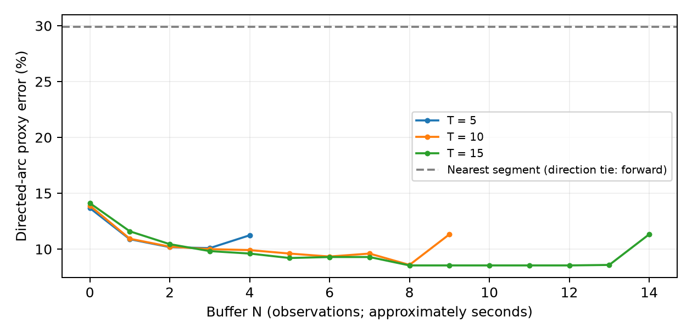

# Real-Time Dense Map Matching with Naive Hidden Markov Models

UE24CS352A Machine Learning mini-project based on the supplied Ahres et al. CS229 paper. A real-time matcher assigns noisy GPS readings to nearby directed road arcs using learned feature scores and fixed-lag Viterbi, without shortest-path searches.

**Team:** G Harish reddy — PES1UG24AM366; SHARANABASAVA H — PES1UG24AM399. Section and assigned problem number were not supplied. Team metadata is in `team.json`.



## Results

The Seattle benchmark contains **7,531 GPS observations**, **158,167 road edges**, **306,182 directed arcs**, and **576 route edges**. Four gaps interrupt nominal 1 Hz sampling. Split: first 4,518 points train weights, next 753 select the configuration, final 2,260 test it.

| Model | T / N | Directed-arc error | Direction-agnostic edge error |
|---|---|---|---|
| Zero-delay HMM | 10 / 0 | 13.89% | 8.67% |
| Validation-selected HMM | 10 / 7 | 9.60% | 4.60% |
| Nearest-segment baseline | — / 0 | 29.91% | 8.01% |

The selected matcher takes approximately **0.54 seconds per 1,000 observations** on the development machine, excluding data preparation and plotting. The geometric baseline breaks directional ties with forward arcs; compare edge error for a fairer baseline. Directed labels are **derived proxies**, constructed by monotone alignment to the published route. This is not an exact reproduction of the paper's iPhone dataset or independent point-level ground truth.

Buffering helps, but the curves are not uniformly convex and the minimum is not always at T/2. Dropping midpoint-distance discrepancy improves error to 8.94%; the full submitted model remains the validation-selected configuration, and this test-set ablation is descriptive.

## Setup

Python 3.11+ is recommended; this package was run on Python 3.14. Windows PowerShell:

```powershell
python -m venv .venv
.\.venv\Scripts\python.exe -m pip install -r requirements.txt
.\.venv\Scripts\python.exe scripts/download_data.py
```

macOS/Linux:

```bash
python3 -m venv .venv
source .venv/bin/activate
python -m pip install -r requirements.txt
python scripts/download_data.py
```

The download script uses `curl`, which must be available on your PATH. It downloads the original Microsoft files and saves their SHA-256 checksums in `data/manifest.json`. If you received the offline ZIP package, its `data/` folder is already populated; skip downloading. Raw benchmark files are excluded from Git; provenance and checksums are included in `results/data_manifest.json`. `requirements-lock.txt` records versions installed on the development machine; use the general requirements for a different Python version/platform.

## Run

Use your environment's Python executable (on Windows, `.\.venv\Scripts\python.exe`):

```bash
python -m src.train_weights
python -m src.evaluate
python run_demo.py --T 10 --N 7 --slice 5300 5600
python scripts/build_deliverables.py
python -m unittest discover -s tests -v
```

Training is separate from the demo. Saved `results/weights.json` is included. First preparation parses the network and creates route-proxy labels, then caches approximately 44 MB locally in `results/prepared.pkl`. Subsequent runs are faster. This pickle is generated by the project; do not load a cache obtained from an untrusted source. Delete that file to rebuild after changing data or feature parameters.

Open `results/demo_map.html` directly in a browser for the demo replay. It uses inline canvas geometry and requires **no internet or external tiles**. Compare `--N 0` and `--N 7` on the same slice, reloading the overwritten HTML after each run. Static `results/demo_map.png` is a backup. `results/map.html` shows the complete held-out selected prediction. The terminal prints error, EOF flush count, and matcher runtime. `--slice START STOP` uses zero-based, stop-exclusive indices; omit it for the whole test set.

## Method and implementation choices

1. Project longitude/latitude to UTM zone 10N (EPSG:32610). Use trailing five-point displacement to derive causal speed and heading, with actual elapsed times.
2. Query a Shapely STRtree for every directed arc within rho=50 m. If none exist, record a nearest-road fallback (there were none in this run). Heading uses the local directed tangent, not the road's endpoint chord.
3. Score distance with a Gaussian density (sigma=10 m), heading with a dot product (neutral at speeds below 1 m/s), and speed with the paper's 40 mph / 120%-of-limit constraint.
4. Score transitions using visited committed arcs (except staying on the same arc) and inverse midpoint-distance discrepancy. This approximate backtrack history preserves a first-order DP; it is not path-specific history for every uncommitted alternative.
5. Train balanced L1 `LinearSVC` emission and transition classifiers independently. Ten expanding training-only time folds with a 15-observation gap select C from {0.1, 1, 10}. Each fold fits its own scaler. Convert coefficients back to raw feature space, clip negative coefficients, discard intercept, and normalize positive coefficients by their L1 sum. These scores are **positive potentials**, not calibrated probabilities. Transition training uses 15-point reference history; inference uses committed-window history.
6. Viterbi operates in log space over T readings. Already committed states that overlap the window are fixed at their correct time indices. At reading t, emit the state at t-N irrevocably. Final N predictions are flushed with reduced future context. For short traces the entire remaining path is flushed. N is a count of readings; timestamp gaps mean latency is not always N seconds.
7. Select T/N on the validation block, then report the complete test sweep (T=5,10,15 and 0<=N<T), baseline and fixed-weight drop-one ablations. Ablations zero a coefficient without retraining; therefore they measure sensitivity of the learned model, not the best retrained reduced model.

Reference per-point labels are constructed with offline distance DP over ordered route occurrences, permitting stay or advance by up to eight route edges with a one-metre-per-edge progression penalty. Reference labels never enter candidate generation or the decoder. Ground truth alignment can nevertheless share GPS distance bias with evaluation, and a single trip cannot establish generalization. No connected-route or route-length mismatch metric is claimed: the naive model can predict disconnected arcs. The finite clamped decoder leaves only N+1 states revisable; T chiefly changes available committed history beyond this.

## Files and deliverables

| Path | Purpose |
|---|---|
| `src/data_loader.py`, `src/candidates.py` | Benchmark parsing, projection, route-label alignment, spatial candidates |
| `src/features.py`, `src/hmm.py` | Five paper-inspired features and fixed-delay Viterbi |
| `src/train_weights.py`, `src/evaluate.py` | Time-blocked learning, selection, test sweep, baseline, ablations |
| `src/pipeline.py`, `src/visualize.py` | Cached preparation and offline maps |
| `results/weights.json`, `summary.json`, CSV files | Learned weights and actual measurements |
| `docs/writeup.pdf` | Two-page PDF covering the guideline's requested sections |
| `docs/writeup_one_page.pdf` | One-page alternative because the guideline's heading conflicts with its body |
| `docs/presentation.pptx`, `docs/presentation.pdf` | 12-slide review presentation with editable deck and PDF backup |
| `docs/demo_and_qa.md` | Live demo sequence and explanation notes |
| `docs/contributions.md`, `docs/deliverables_checklist.md` | Honest contribution record and remaining submission actions |

The faculty guidelines are the source of deliverable requirements. The user-created completion guide was used as an implementation aid. A review session, actual team contributions, GitHub invitations, and submission cannot be represented as completed by producing local files.

## Private GitHub publication

The local project is prepared for a private repository, but has not been published. Use a connected GitHub account or create a private repository in GitHub, then push the project. Do not upload `.venv/`, `.tools/`, `data/`, or local caches. Invite the faculty and assigned TAs using their actual GitHub usernames and verify access. Update `team.json` with section, problem number and repository URL, then regenerate documents. Each member should record their actual review/changes in commits under their own account; no fabricated history or attribution is included.

## References

- Ahres, Jambulapati, Janssen and Kangaspunta, *Real-Time Dense Map Matching with Naive Hidden Markov Models: Delay versus Accuracy*, supplied Stanford CS229 final-project paper.
- [Newson and Krumm (2009), original paper and Seattle benchmark](https://www.microsoft.com/en-us/research/publication/hidden-markov-map-matching-noise-sparseness/), DOI: 10.1145/1653771.1653818.
- Forney (1973), *The Viterbi Algorithm*, Proceedings of the IEEE, 61(3), 268–278.
